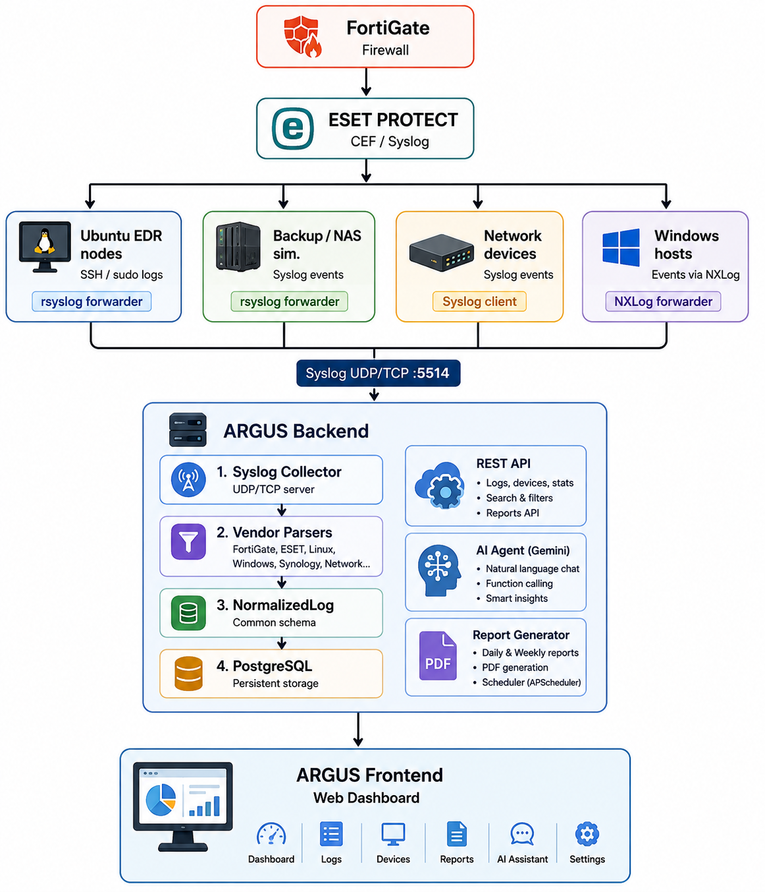

# ARGUS — Security Operations Center (SOC) Platform

ARGUS is a network security monitoring and log management platform designed for a lab-based SOC environment. It collects syslog events from security and network devices, normalizes them into a common schema, stores them in PostgreSQL, exposes a REST API, provides a web dashboard, generates PDF security reports, and integrates an AI assistant for security-event analysis.

The project is designed to run in a Docker-based environment and can be deployed in a GNS3 lab.

> **Project status:** MVP / lab project. Authentication, database migrations, and production hardening still need to be added before exposing the platform to an untrusted network.

## ✨ Features

- **Centralized syslog collection**
  - UDP and TCP syslog ingestion on port `5514`
  - Designed for FortiGate, ESET PROTECT, Synology/NAS-style logs, Linux/Windows systems, and network equipment
- **Log normalization**
  - Vendor-specific parsers convert raw events into a common `NormalizedLog` structure
- **PostgreSQL storage**
  - Persistent storage for normalized security events and device information
- **REST API**
  - FastAPI-based API with automatically generated Swagger/OpenAPI documentation
- **SOC dashboard**
  - Frontend for logs, devices, statistics, reports, and operational status
- **AI security assistant**
  - Gemini integration with function calling
  - Can search logs, retrieve statistics, and list devices
- **PDF reporting**
  - Daily and weekly reports generated from real collected data
  - Optional automatic scheduling through APScheduler
- **Docker deployment**
  - Separate backend/frontend containers with production Docker Compose configuration
- **GNS3-ready architecture**
  - Includes deployment instructions for a FortiGate, ESET PROTECT, Ubuntu EDR nodes, and a simulated backup/NAS server

## 🏗️ Architecture



## 📁 Repository Structure

```text
ARGUS-SOC/
│
├── Architecture.png
├── Caddyfile
├── DEPLOYMENT.md
├── docker-compose.prod.yml
├── README.md
│
├── backend/
│   ├── .env
│   ├── docker-compose.yml
│   ├── Dockerfile
│   ├── README.md
│   ├── requirements.txt
│   │
│   ├── app/
│   │   ├── config.py
│   │   ├── database.py
│   │   ├── main.py
│   │   ├── models.py
│   │   ├── schemas.py
│   │   ├── __init__.py
│   │   │
│   │   ├── agent/
│   │   │   ├── service.py
│   │   │   ├── tools.py
│   │   │   └── __init__.py
│   │   │
│   │   ├── api/
│   │   │   ├── routes_agent.py
│   │   │   ├── routes_devices.py
│   │   │   ├── routes_logs.py
│   │   │   ├── routes_reports.py
│   │   │   ├── routes_stats.py
│   │   │   └── __init__.py
│   │   │
│   │   ├── collector/
│   │   │   ├── pipeline.py
│   │   │   ├── syslog_server.py
│   │   │   ├── __init__.py
│   │   │   └── parsers/
│   │   │       ├── base.py
│   │   │       ├── eset.py
│   │   │       ├── fortigate.py
│   │   │       ├── linux.py
│   │   │       ├── network.py
│   │   │       ├── synology.py
│   │   │       ├── unknown.py
│   │   │       ├── windows.py
│   │   │       └── __init__.py
│   │   │
│   │   ├── reports/
│   │   │   ├── generator.py
│   │   │   ├── scheduler.py
│   │   │   ├── service.py
│   │   │   └── __init__.py
│   │   │
│   │   └── storage/
│   │       ├── repository.py
│   │       └── __init__.py
│   │
│   ├── data/
│   │   └── reports/
│   │
│   └── scripts/
│       ├── send_test_logs.py
│       └── test-logs.py
│
├── frontend/
│   ├── .dockerignore
│   ├── Dockerfile
│   ├── index.html
│   ├── nginx.conf
│   ├── package-lock.json
│   ├── package.json
│   ├── postcss.config.js
│   ├── tailwind.config.js
│   ├── vite.config.js
│   │
│   └── src/
│       ├── App.jsx
│       ├── index.css
│       └── main.jsx
│
└── Screenshots/
    ├── Capture d’écran (225).png
    ├── Capture d’écran (226).png
    ├── Capture d’écran (227).png
    └── Capture d’écran (228).png

## 🛠️ Technology Stack

| Layer | Technology |
|---|---|
| Backend | Python |
| API | FastAPI |
| Database | PostgreSQL |
| Syslog | UDP / TCP |
| Frontend | React + Vite |
| Styling | Tailwind CSS |
| Reverse proxy | Caddy |
| Containers | Docker / Docker Compose |
| PDF reports | ReportLab |
| Scheduling | APScheduler |
| AI | Google Gemini via `google-genai` |
| Lab environment | GNS3 |

## 🚀 Quick Start

### 1. Clone the repository

```bash
git clone https://github.com/<your-username>/ARGUS-SOC.git
cd ARGUS-SOC
```

### 2. Configure the backend

Create your local environment file from the example provided by your project:

```bash
cd backend
cp .env.example .env
```

Edit `.env` and configure your PostgreSQL connection and, if you want to use the AI assistant:

```env
GEMINI_API_KEY=your_api_key
```

> **Never commit real API keys, database passwords, or other secrets to GitHub.**
> Make sure `.env` is included in `.gitignore`.

### 3. Start the backend

```bash
docker compose up --build
```

The API documentation is available at:

```text
http://localhost:8000/docs
```

The backend listens for syslog traffic on:

```text
UDP 5514
TCP 5514
```

### 4. Test the collector without real devices

From the `backend` directory:

```bash
pip install -r requirements.txt
python scripts/send_test_logs.py 127.0.0.1 5514
```

Then query the API:

```bash
curl "http://localhost:8000/api/logs?limit=20"
curl "http://localhost:8000/api/logs?source_type=fortigate&severity=critical"
curl "http://localhost:8000/api/devices"
```

## 🤖 AI Assistant

ARGUS integrates Google's official `google-genai` SDK.

The assistant can use backend functions to:

- Search security logs
- Retrieve statistics
- List monitored devices
- Build a response based on the retrieved security data

Configure your Gemini API key in `.env`:

```env
GEMINI_API_KEY=your_api_key
```

Then test the assistant:

```bash
curl -X POST http://localhost:8000/api/agent/chat \
  -H "Content-Type: application/json" \
  -d '{"message": "Summarize today'\''s critical events"}'
```

If no Gemini API key is configured, the API returns an explicit message instead of crashing, allowing the rest of the platform to be developed independently.

## 📊 API Endpoints

| Method | Endpoint | Purpose |
|---|---|---|
| GET | `/api/logs` | Search and filter security logs |
| GET | `/api/devices` | List monitored devices |
| PATCH | `/api/devices/{id}` | Update device metadata |
| GET | `/api/stats/overview?hours=24` | Dashboard statistics |
| POST | `/api/agent/chat` | Query the AI security assistant |
| GET | `/api/reports` | List generated reports |
| POST | `/api/reports/generate` | Generate a daily or weekly report |
| GET | `/api/reports/{id}/download` | Download a PDF report |
| GET | `/health` | Health check |

## 🧩 Normalized Log Model

ARGUS converts vendor-specific events into a common structure:

```text
timestamp
source_ip
source_type
source_device
severity
event_type
src_ip
dst_ip
user
message
raw
extra
```

Severity levels currently include:

```text
critical
warning
info
```

This normalized model allows the API, dashboard, reporting system, and AI assistant to work with a common representation instead of depending on one vendor's raw log format.

## 🔌 Supported / Planned Log Sources

The project currently includes parsers for:

- FortiGate
- ESET PROTECT
- Linux
- Windows
- Synology-style logs
- Network devices
- Unknown / fallback events

To add another vendor:

1. Create a parser under `backend/app/collector/parsers/`.
2. Inherit from `BaseParser`.
3. Implement `matches()`.
4. Implement `parse()` and return a `NormalizedLog`.
5. Register the parser.
6. Import it from the parser package.

The rest of the pipeline can continue working with the normalized schema.

## 🖥️ GNS3 Production-Lab Deployment

The repository includes a dedicated deployment guide:

```text
DEPLOYMENT.md
```

The reference lab contains:

| Node | Example IP | Role |
|---|---:|---|
| Forti-Firewall | `192.168.1.1` | Perimeter firewall |
| ESETProtect-1 | `192.168.1.10` | ESET PROTECT console |
| Serveur-APK | `192.168.1.20` | ARGUS server |
| Backup-Server | `192.168.1.100` | NAS/backup simulator |
| EDR-1 / EDR-2 / EDR-3 | `192.168.1.21-23` | Ubuntu + ESET agent |

The reference deployment forwards syslog traffic to:

```text
192.168.1.20:5514
```

For the complete device configuration and verification procedure, see [`DEPLOYMENT.md`](DEPLOYMENT.md).

## 📝 PDF Reports

ARGUS can generate reports from collected data, including:

- Event statistics
- Critical events
- Device inventory
- Daily or weekly reporting periods

Manual generation:

```bash
curl -X POST http://localhost:8000/api/reports/generate \
  -H "Content-Type: application/json" \
  -d '{"period": "daily"}'
```

Scheduled reports can be enabled through:

```env
ENABLE_SCHEDULED_REPORTS=true
```

The current schedule is:

- Daily at 05:00 UTC
- Weekly on Monday at 06:00 UTC

## 🔐 Security Notes

This project is primarily intended for a controlled lab environment.

Before any real-world deployment:

- Add API authentication and authorization.
- Do not commit `.env` files or secrets.
- Use strong PostgreSQL credentials.
- Put the application behind HTTPS.
- Restrict syslog access with firewall rules.
- Review Docker permissions and container capabilities.
- Add database migrations (for example, Alembic).
- Configure proper backups and log retention.
- Rotate API keys and credentials.
- Review the exposure of the AI endpoint and rate-limit it.

## 🧪 Verification Checklist

After deployment, verify the following:

```bash
# Check connectivity to the syslog listener
nc -zvu 192.168.1.20 5514

# Check devices
curl http://192.168.1.20/api/devices

# Check logs
curl "http://192.168.1.20/api/logs?limit=20"

# Check the application
curl http://192.168.1.20/health

# Test the AI assistant
curl -X POST http://192.168.1.20/api/agent/chat \
  -H "Content-Type: application/json" \
  -d '{"message": "Summarize today'\''s critical events"}'

# Generate a PDF report
curl -X POST http://192.168.1.20/api/reports/generate \
  -H "Content-Type: application/json" \
  -d '{"period": "daily"}'
```

If something fails, check in this order:

```text
1. GNS3 network connectivity
2. Ubuntu firewall / UFW rules
3. Docker containers
4. Backend container logs
5. Syslog listener connectivity
6. Parser configuration
```

For Docker logs:

```bash
docker compose -f docker-compose.prod.yml logs backend --tail=50
```

## 📚 Documentation

- [`DEPLOYMENT.md`](DEPLOYMENT.md) — GNS3 and production-lab deployment
- [`backend/README.md`](backend/README.md) — backend architecture, API, parsers, and development information

## 🗺️ Roadmap

Potential next steps include:

- [ ] API authentication and authorization
- [ ] Alembic database migrations
- [ ] Multi-source event correlation
- [ ] More vendor-specific parsers
- [ ] Advanced SOC alerting and detection rules
- [ ] Improved AI investigation workflows
- [ ] Production-grade observability
- [ ] Stronger secrets management
- [ ] Automated testing and CI/CD

## ⚠️ Disclaimer

ARGUS is an educational and laboratory security project. It should not be considered production-ready security software without additional hardening, authentication, monitoring, testing, and security review.

## 👤 Project

**ARGUS SOC** — Network Security Monitoring & SOC Lab Platform

Built as a cybersecurity/networking project using Docker, FastAPI, PostgreSQL, React, GNS3, and AI-assisted security analysis.
